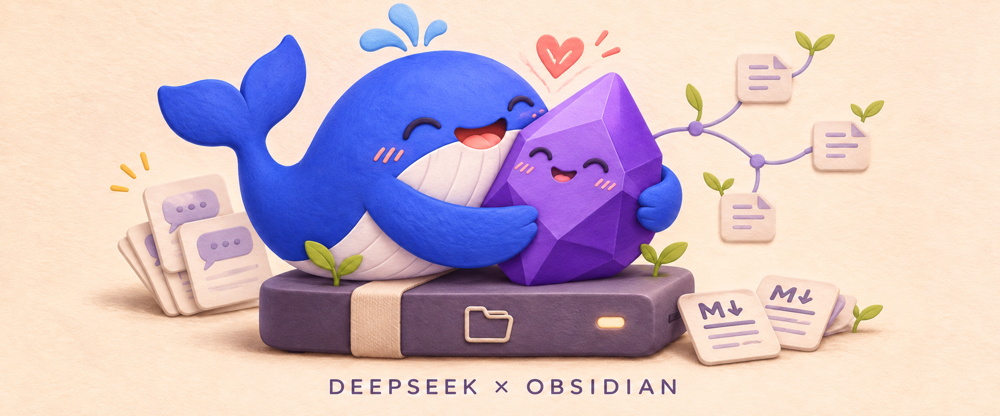
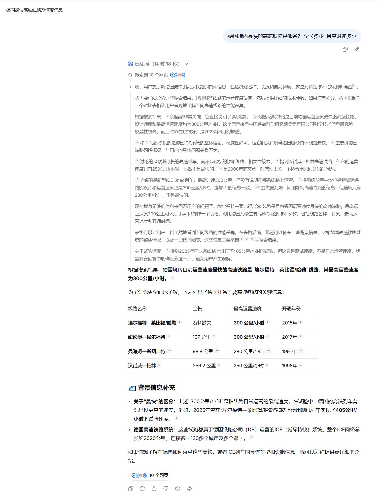
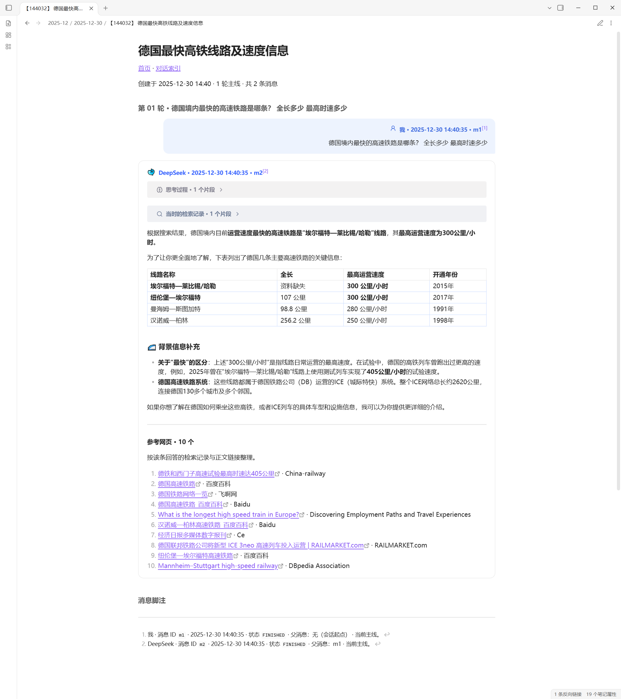
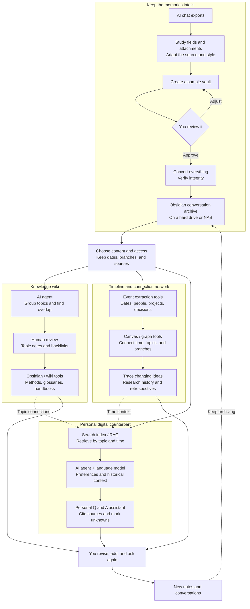

<p align="center"><a href="README.md">简体中文</a> · <strong>English</strong></p>



# DeepSeek Obsidian Epitaph ✝️

**A home for old conversations. A head start for your future knowledge base.**

> Bro, Uncle Liang may be short on GPUs. Your hard drive still has room.

Chat windows close. Sidebars grow. That answer you *know* you saw is usually another eight scrolls away.

The conversations aren't gone. The tokens we burned (not my money, anyway) now live on as Markdown, attachments, and footnotes. A different format. The same questionable late-night questions.

This skill turns AI chat exports into readable Obsidian conversation notes. DeepSeek v3 works directly; other sources need a format adapter first. It keeps the dialogue, branches, formulas, code, and attachments together. **An archive today. Source material for your knowledge base tomorrow.**

## 🐋 From “server busy” to “browse locally”

The same conversation about German high-speed rail, before and after archiving.

<details>
<summary><strong>① Still in DeepSeek: expand the original interface</strong></summary>

The author supplied this screenshot, with reasoning and search records expanded in the original chat.



</details>

**② Settled into Obsidian: right-aligned questions, a whale for DeepSeek, and collapsible reasoning and search records.**



The result was captured directly from Obsidian's native Electron rendering. These two real screenshots are included at the author's request. All runnable fixtures and the bundled demo vault remain synthetic.

From the arrival of V3 and R1, which seemed to come out of nowhere, to a V4 that now feels to me as though it is falling behind, DeepSeek hasn't given me that early-2025 feeling in a while: that the world had suddenly taken a step forward. But I still want to keep those conversations. The surprise of watching it unpack a problem. The stubborn late-night follow-ups. The few times I thought I had finally understood something. New models will overtake old ones; that doesn't erase what those moments meant. **I want a lasting home for them, and a record of the curious person I was when I asked.**

So the conversations move out of an ever-changing sidebar and into folders you can keep. On your hard drive, or on your NAS. Open Obsidian and they are still questions and answers, with their dates, branches, attachments, and web sources intact. The title says epitaph. The ideas inside still have some growing to do.

## 🌱 An archive with a second career

An archive answers “what did we actually discuss?” It preserves messages, timestamps, historical branches, statuses, and the attachments that exist in the export.

A knowledge base asks “what can I do with this later?” Stable files, dates, sources, and links give other tools something useful to work with. An AI agent can help organize topics. Linked notes can grow into a wiki. A timeline can trace an idea back to its beginnings. Retrieval can help answer “why did I make that choice?”

This skill takes the process through a complete archive. The second half of the diagram shows directions you can explore with additional tools, configuration, and human review.



A wiki can answer “what have I learned?” A timeline and connection network can answer “how did I reach that conclusion?” A personal digital counterpart can retrieve past preferences, reasons, and phrasing from material you authorize, with sources you can inspect. The same archive can give a study assistant material for revision questions, a writing assistant context for a draft, or a project agent the reasoning behind an old decision.

**Your drive can remember. Tools can help you rediscover. You still decide what to trust and what to keep.**

## 📦 What gets a room in the archive?

| In the old chat | In the vault |
|---|---|
| Questions and answers | Role-based bubbles, read as a conversation |
| Reasoning and historical searches | Folded until you need them |
| Referenced and searched web pages | A clickable list below each answer, deduplicated in order |
| Retries, old branches, timeouts | Original statuses preserved; even failed attempts get a seat |
| Tables, formulas, images | Converted for Obsidian reading |
| Long code and HTML | Collapsible source plus separate files; never auto-executed |
| Missing attachments | Clearly marked, never conjured out of thin air |
| Dates, source, conversation IDs | Note properties for organization and queries |
| Original conversations | gzip copies for tracing back to the source |

One conversation per note, filed by creation date:

```text
YYYY-MM/YYYY-MM-DD/【HHMMSS】 Conversation title.md
```

`【HHMMSS】` is the creation time. Native message footnotes provide return links. Basic reading uses Obsidian Markdown, callouts, and CSS; no community plugin required.

## 🚚 Tour the demo before moving everything in

Requires **Python 3.13+**, standard library only. Keep the export and output directories separate. From the repository root:

```sh
python scripts/convert.py inspect --source input/deepseek-export --report output/structure.json
python scripts/convert.py demo --source input/deepseek-export --dest output/review-vault
```

Open `output/review-vault` in Obsidian. Check the conversations, folders, branches, and attachments. **After approving the demo**, run:

```sh
python scripts/convert.py full --source input/deepseek-export --dest output/chat-vault --reviewed-demo output/review-vault --approved
python scripts/verify_vault.py --source input/deepseek-export --vault output/chat-vault --report output/verification.json
```

`--approved` records approval you already gave; it is not permission for an agent to skip you. Changes to the export, style, timezone, or converter require a new demo. The new entry point writes only to empty directories, so your edited notes keep their furniture.

Prefer a test drive without your private conversations?

```sh
python scripts/build_demo.py --dest output/synthetic-demo
```

Or open [examples/demo-vault](examples/demo-vault/00-首页.md). Its six synthetic scenarios contain **25 messages, 33 fragments, two images, and one missing-attachment record**. These are test actors, not someone's private chats drafted into service.

### Give an agent the house rules

[SKILL.md](SKILL.md) is the entry point. Keep the relative layout of `scripts/`, `assets/`, `references/`, and fixtures. Ask an agent that supports local skills:

> Use deepseek-obsidian-epitaph to inspect my AI chat export. Study the message content, IDs, timestamps, and attachments, then create an Obsidian demo for me to review. After I approve it, convert the complete export and verify integrity.

For unsupported exports, follow the [adapter guide](references/other-providers.md): study the schema, preserve the originals, implement the mapping and provider style, then review a demo. Native parsers for ChatGPT, Claude, and other services are not bundled as ready-made features.

<details>
<summary><strong>For anyone who likes looking under the hood</strong></summary>

```sh
python -m unittest discover -s tests -v
python scripts/check_public_content.py
```

The tests cover archive completeness, code preservation, resource links, reproducibility, and overwrite protection. The public-content check regenerates the synthetic input and example vault and verifies the current version file hashes.

Actual test and native Obsidian checks are recorded in [verification results](references/verification-results.json). Data integrity, sampled visual checks, and the real showcase screenshots each have their own scope.

Optional Obsidian integration checks and environment limits are documented in [verification](references/verification.md). Further technical references are currently in Chinese:

- [Capability scope](references/frozen-scope.md)
- [DeepSeek v3 input structure](references/export-v3.md)
- [Vault format and maintenance](references/vault-format.md)
- [Changelog](CHANGELOG.md) · [Visual sources and production notes](references/visual-assets.md)

</details>

## A note to the part of me that is still curious

I don't know where AI will take us. A beautiful piece of reasoning still excites me; a confidently wrong answer still makes me pause. I want to get closer to it without handing over my judgment. That curiosity comes with hope and a little awe: at abilities I don't yet understand, at the lives they might change, and at consequences we may not yet know how to carry.

I keep these conversations to remember how I asked, what persuaded me, and when I changed my mind. Years from now, I may laugh at how naive I was. I may also find that an idea which later mattered was already hiding in an offhand follow-up question.

If this little archive has a wish, it is that we occasionally look back while chasing the next astonishing thing. **Keep exploring. Keep questioning. May we never lose the nerve to ask.**

---

The project remains in private development; an open-source license has not yet been selected. See [LICENSE](LICENSE). Please report issues with synthetic minimal reproductions to protect private chats and attachments.
