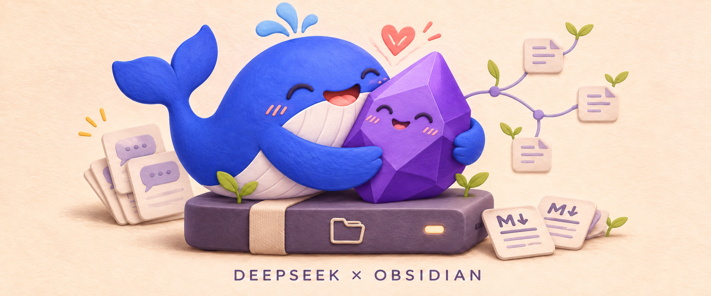
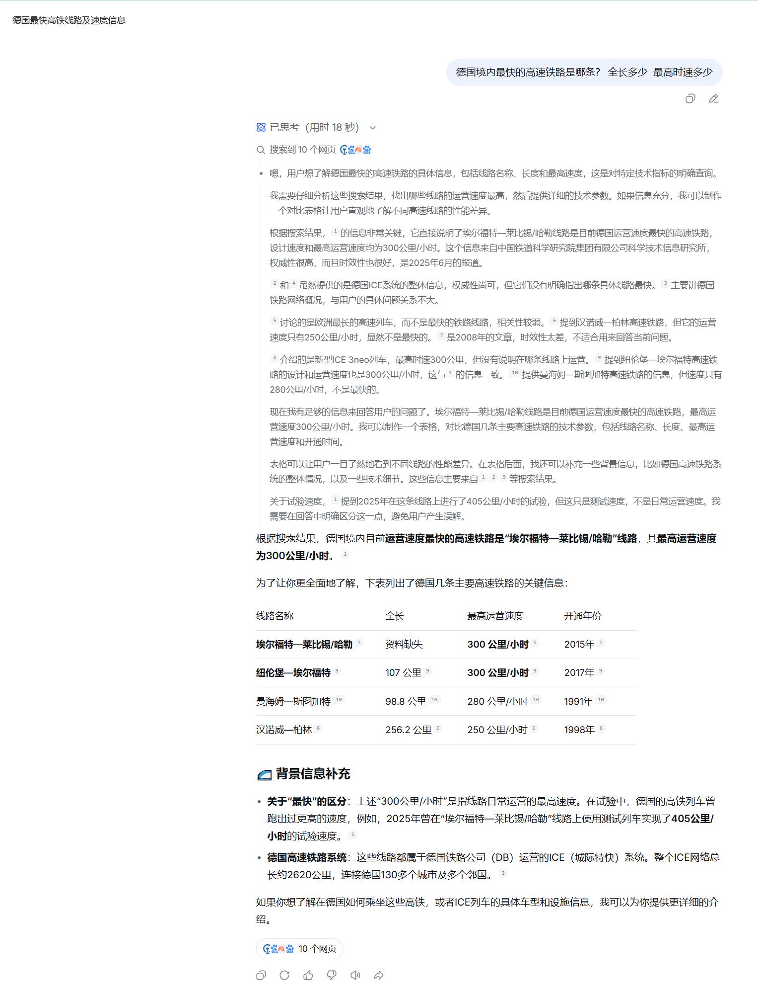
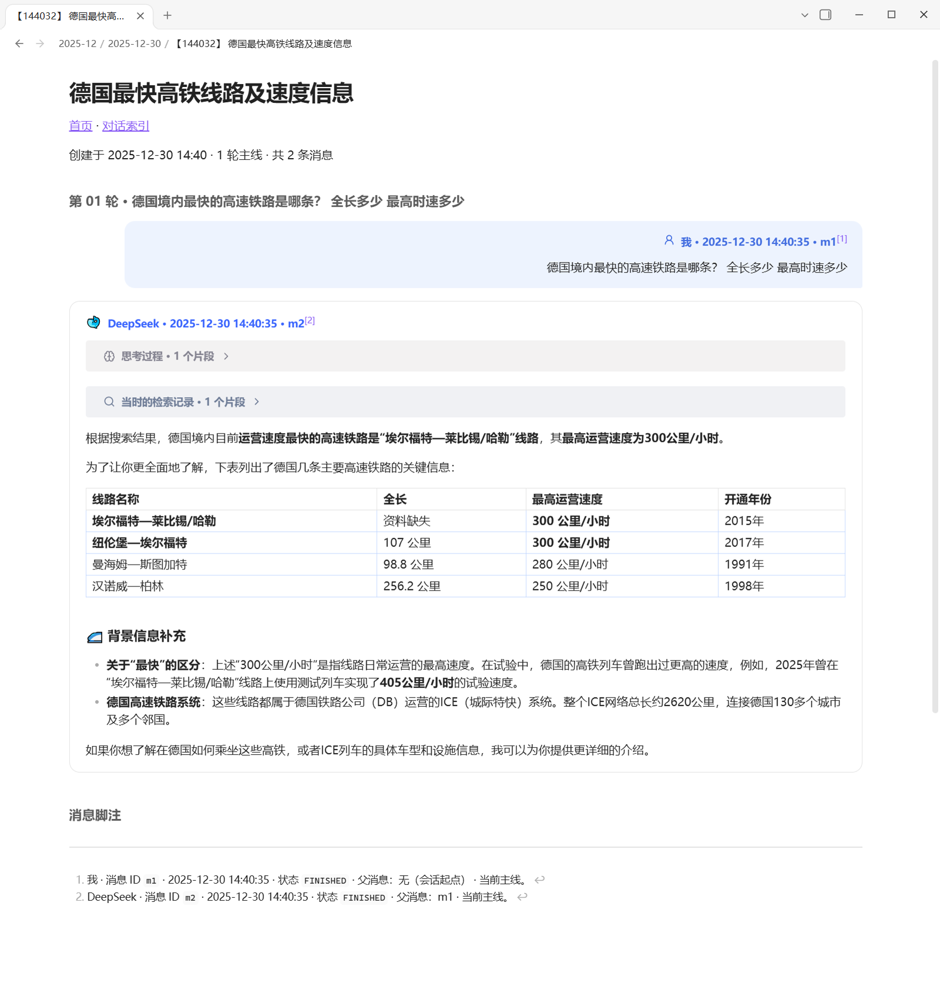
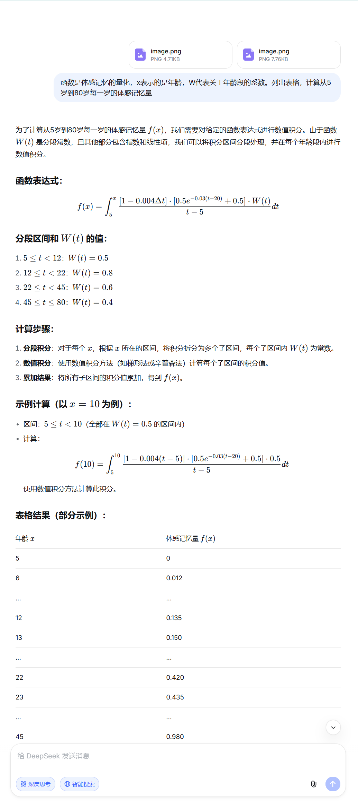
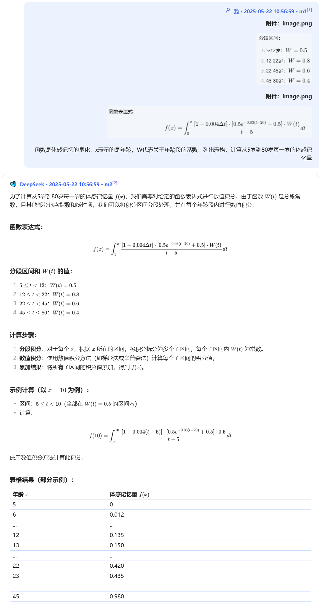
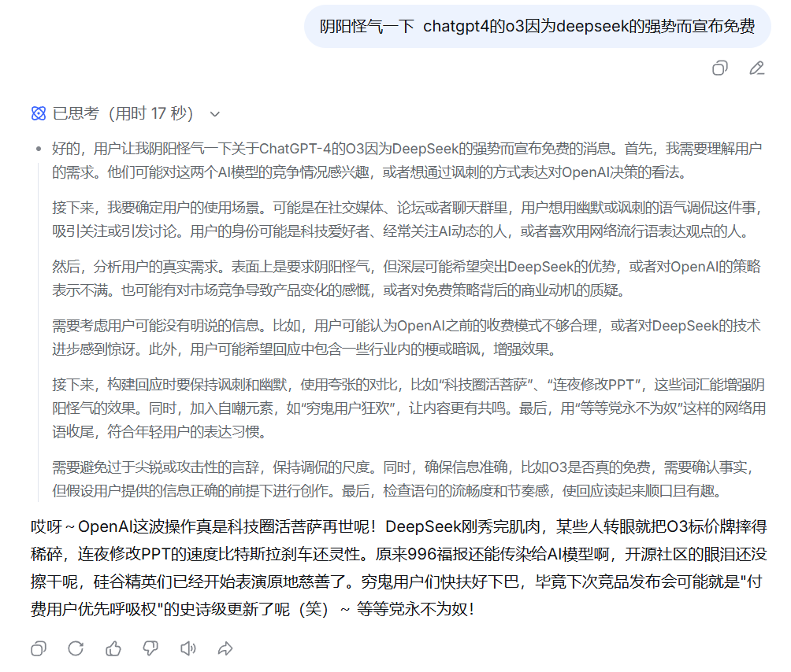
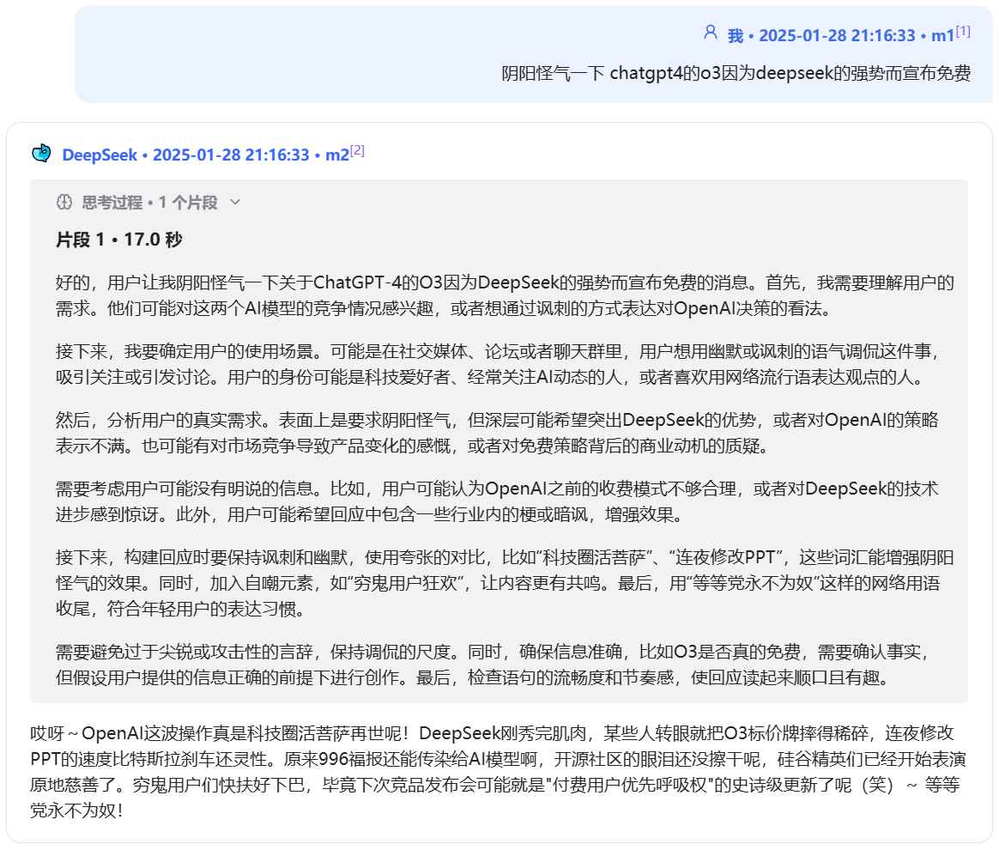
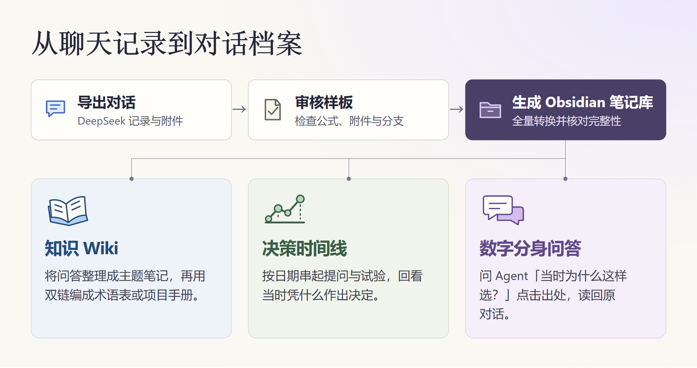

<p align="center"><strong>简体中文</strong> · <a href="README.en.md">English</a></p>

# DeepSeek 的 Obsidian 墓志铭 ✝️

**给聊过的天一个家，给未来的知识库留点家底。**

> 哥们，梁叔叔算力是不够了，但是你的硬盘够啊。

这是一个把 DeepSeek 聊天记录转成 Obsidian 笔记库的 Agent Skill。

聊天窗口会关，侧栏会长，那个“我记得它讲过”的回答，往往藏在第八次滚动之后。

以前的对话不是没了。消耗的 token（反正不是我的钱），只是换成了 Markdown、附件和脚注，以另一种方式继续陪伴你。

目前支持 DeepSeek v3 导出格式。问答按轮次排列，旧分支、公式、代码和附件都能在原处找到。**今天是聊天档案，明天是你知识库的素材源。**

## 🐋 从“服务器繁忙”到“本地随便翻”

### 德国最快高铁线路及速度信息

表格保留在线路说明里，回答末尾列出 10 个网页来源。

<details>
<summary>查看 DeepSeek 网页原图</summary>



</details>



### 体感记忆量计算与分段积分方法

两个同名图片附件分别显示，积分公式与结果表可以对照阅读。两图都截到 45 岁这一行。

<details>
<summary>查看 DeepSeek 网页原图</summary>



</details>



### 阴阳怪气一下 chatgpt4的o3因为deepseek的强势

展开「思考过程」，可以看到当时记录的 17 秒思考，以及它最后写出的那段调侃。

<details>
<summary>查看 DeepSeek 网页原图</summary>



</details>



## 我为什么留下这些对话

从横空出世的 V3 和 R1，到如今在我眼里渐渐跟不上时代的 V4，DeepSeek 已经很久没有带给我 2025 年初那种“世界突然往前走了一大步”的震撼了。但我还是想留住那些对话：第一次看它把问题拆开时的惊讶，深夜里反复追问的执拗，还有几次以为自己终于想明白了什么的快乐。模型会被新的模型超越，那些时刻却不会因此作废。**我想给它们找个能长久住下来的地方，也给当时那个充满好奇的自己留一份底稿。**

于是，聊天从不断刷新的侧栏，搬进了可以自己保管的文件夹。存在你的硬盘里，也可以存在你的 NAS 里；打开 Obsidian，它们依然是一问一答，带着当时的时间、分支、附件和网页来源。名字是墓志铭，里面埋着的却都是还想继续生长的念头。

## 🌱 聊天归档，也是知识库的原料仓

归档解决“当时到底聊了什么”：保留问答、时间、历史分支、消息状态，以及能找到的原始附件。

样板确认后，Skill 将全部对话转成 Obsidian 笔记，并核对消息、分支和附件。归档完成后，你可以用双链编 Wiki，用 Canvas 回看决策，也可以让 AI Agent 检索旧对话，回答「我当时为什么这样选？」

<picture>
  <source media="(max-width: 620px)" srcset="assets/pics/chat-archive-zh-mobile.png">
  
</picture>

**硬盘可以替你记住，工具可以帮你重新发现。至于哪些值得相信、哪些值得留下，仍由你决定。**

## 📦 都给老对话安排了什么

| 旧聊天里的东西 | 在笔记库里的待遇 |
|---|---|
| 问题和回答 | 分角色气泡，继续按对话阅读 |
| 思考与历史检索 | 默认折叠，需要时再展开 |
| 引用与检索网页 | 在对应回答末尾列成可点击列表，按顺序去重 |
| 重试、旧分支、超时 | 保留原状态；失败的那几次也有席位 |
| 表格、公式、图片 | 转成适合 Obsidian 阅读的格式 |
| 长代码和 HTML | 折叠源码，另存文件；不自动执行 |
| 缺失附件 | 明确标注，绝不现场脑补一个 |
| 时间、来源、会话 ID | 放进笔记属性，方便标签管理和查询 |
| 原始会话 | gzip 留档，方便回溯转换前的内容 |

目录长这样，找旧账相当顺手：

```text
YYYY-MM/YYYY-MM-DD/【HHMMSS】 对话标题.md
```

`【HHMMSS】` 是创建时分秒。每段对话一篇笔记，消息脚注可点击回跳；基础阅读使用 Obsidian 原生 Markdown、callout 和 CSS，无须社区插件。

## 🚚 先看样板间，再让老聊天搬家

需要 **Python 3.13+**，只用标准库。先取得导出的目录，别把输入和输出放成套娃。在仓库根目录运行：

```sh
python scripts/convert.py inspect --source input/deepseek-export --report output/structure.json
python scripts/convert.py demo --source input/deepseek-export --dest output/review-vault
```

用 Obsidian 打开 `output/review-vault`：看看目录顺不顺手、问答像不像聊天、分支有没有漏、附件有没有安顿好。**样板认可后**，再运行：

```sh
python scripts/convert.py full --source input/deepseek-export --dest output/chat-vault --reviewed-demo output/review-vault --approved
python scripts/verify_vault.py --source input/deepseek-export --vault output/chat-vault --report output/verification.json
```

`--approved` 不是“略过用户”的后门，而是已有审核结果的声明。源文件、样式、时区或转换规则变化，会要求重做样板。新入口只写空目录，已有笔记不用担心被顺手重新装修。

还不想拿真聊天试？先让六位合成网友入住：

```sh
python scripts/build_demo.py --dest output/synthetic-demo
```

也可直接打开 [examples/demo-vault](examples/demo-vault/00-首页.md)。六组样例有 **25 条消息、33 个片段、2 张图片和 1 条缺失附件记录**；它们是测试演员，不是从谁的聊天记录里抓来的临时工。

### 让 Agent 接手

仓库根目录的 [SKILL.md](SKILL.md) 就是技能入口。保留 `scripts/`、`assets/`、`references/` 和 fixtures 的相对位置，让支持本地 Skill 的 Agent 读取它：

> 使用 deepseek-obsidian-epitaph 检查我的 AI 聊天导出。先研究正文、ID、时间和附件，做几个 Obsidian 样板给我看；我确认后，再转全量并核对完整性。

遇到未支持来源，Agent 按 [适配指南](references/other-providers.md) 调查字段、保留原始数据、建立适配与来源样式，再走样板审核。当前没有把 ChatGPT、Claude 等平台的原生解析器包装成现成功能。

<details>
<summary><strong>给爱翻引擎盖的朋友：验证、格式与维护</strong></summary>

```sh
python -m unittest discover -s tests -v
python scripts/check_public_content.py
```

归档测试检查内容完整性、代码保留、资源引用、重建一致性和覆盖保护；公开内容检查重新生成合成输入与演示库，并核对当前版本文件哈希。

测试及 Obsidian 原生检查的执行结果保存在 [验证记录](references/verification-results.json)。结构核验、样板视觉检查与真实展示截图各自说明范围，不互相冒领功劳。

可选的 Obsidian 集成检查及环境限制见[验证说明](references/verification.md)。更多细节：

- [能力范围](references/frozen-scope.md)
- [DeepSeek v3 输入结构](references/export-v3.md)
- [笔记格式与维护规则](references/vault-format.md)
- [变更记录](CHANGELOG.md) · [图片来源与制作说明](references/visual-assets.md)

</details>

## 写给仍然好奇的自己

我不知道 AI 最终会把我们带到哪里。我会为一次漂亮的推理兴奋，也会在它一本正经地犯错时停下来；我想靠近它，又不愿把自己的判断轻易交出去。这份好奇里有期待，也有敬畏——对尚未理解的能力，对它可能改变的生活，也对那些我们还没有学会承担的后果。

留下这些对话，是想记住自己曾经怎样提问、怎样被说服，又怎样改变了主意。也许几年后重读，会笑当年的天真，也会发现某个后来很重要的念头，早就藏在一句随口的追问里。

如果这座小小的档案馆有什么愿望，我希望它能让我们在追赶下一次惊叹时，偶尔停下来看看来路。**继续探索，也继续怀疑；愿我们始终保有提问的勇气。**
